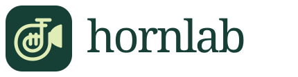

# HornLab



I'm Om, a high school senior and French horn player. I started HornLab because finding time to practice was already hard enough between classes and band. When I did have 20 or 30 minutes, I could spend way too much of it figuring out what to work on.

HornLab is the practice app I've been building around that problem. It keeps my pieces, passage goals, and notes together, and helps me decide where to start. I'm not in band anymore, but I still care about making this useful for people who are.

**[Try HornLab](https://hornlab.pythonanywhere.com)** · [Why I built it](https://hornlab.pythonanywhere.com/about)

## What my friends thought

I had five of my French horn friends try the PythonAnywhere site. They thought it was really cool, but one thing came up: entering all their repertoire took a while. That was useful feedback because setting up a practice app shouldn't take up the time you wanted to spend practicing.

So I changed the entry process:

- You can add a piece with just its name. The deadline, priority, and other details are still there if you want them.
- If you have several pieces, you can paste a list instead of filling out the same form over and over. It previews the list and skips names you've already added, including archived pieces.
- **Save & practice** takes you straight into the practice room. Existing pieces have a **Practice** button too, so you don't have to set up a separate passage first.

I still need to have them try this version and see what feels better and what still takes too long. [My feedback notes](PILOT.md) are in the repo too.

## What you can do

- Keep track of pieces, deadlines, and what needs the most work.
- Build a session around the time you actually have.
- Work on a passage, mark clean attempts, and gradually raise the tempo.
- Record a take, listen back, and compare it with another one.
- Use a metronome with different meters, subdivisions, and accents.
- Save practice notes and see your weekly minutes and passage results.

There's also an optional AI coach. It uses your time, workload, passage goals, and reported results to suggest a plan. It doesn't listen to your recordings or judge how well you played. [AI setup](AI_SETUP.md)

## Try it

1. Create an account and a practice profile on the [live site](https://hornlab.pythonanywhere.com).
2. Open **Repertoire**, add a piece name, and choose **Save & practice**. **Paste a list** works for several pieces at once.
3. Play a passage and tap **Clean** or **Again**. After enough clean attempts, you can try a slightly faster tempo.
4. Record a take if you want to listen back, then use **Finish & save** to keep your session.

Quick practice uses your next passage goal if you already have one. Otherwise, it starts with a whole-piece goal at 60 BPM, a target of 100 BPM, and three clean repetitions. Those are just starting settings. You can edit the tempo, measures, and repetition goal in Repertoire.

## Run it yourself

You'll need Python 3.10 or newer.

```sh
git clone https://github.com/dubeyom212-stack/HornLab.git
cd HornLab
python -m venv .venv
```

Activate the environment:

```powershell
# Windows PowerShell
.\.venv\Scripts\Activate.ps1
```

```sh
# macOS / Linux
source .venv/bin/activate
```

Then install the packages and start it:

```sh
python -m pip install -r requirements.txt
python app.py
```

Open http://127.0.0.1:5000. [RUN.md](RUN.md) has more setup help, and [WEB.md](WEB.md) covers PythonAnywhere hosting.

## How it's built

Python and Flask handle the backend, with Flask-SQLAlchemy and SQLite for saved data. The interface is plain HTML, CSS, and JavaScript. Recording uses the browser's MediaRecorder API, and audio stays in IndexedDB on your device.

Pieces and saved sessions belong to your account. Recordings and unfinished practice stay in the browser where you made them, so they won't appear on another device. Download any takes you want to keep. The database is normally in `instance/hornlab.db`; keep a backup before updating the app.

## Checking changes

```sh
python -m unittest discover -v
node --test test_metronome.cjs test_practice.cjs
```

The tests check saved data, planning, account separation, repertoire entry, and practice controls. The recording tests use simulated devices, so trying real microphones and phones is still part of the work.

I want to keep improving this based on what musicians actually find useful. Right now, the main thing is getting people from opening the app to playing their instrument with less setup.
